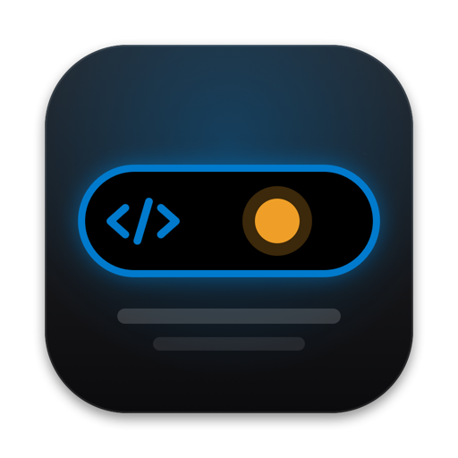
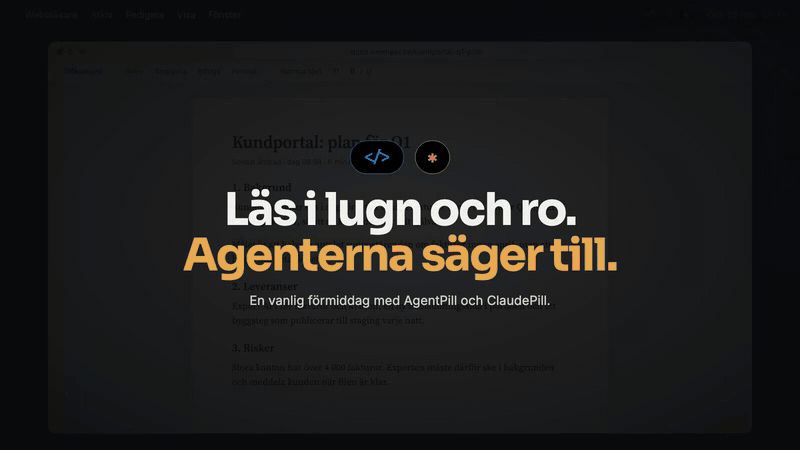

<p align="center"></p>

# 💊 AgentPill

[](https://www.apple.com/macos/)
[](https://swift.org)
[](LICENSE)

> **A menu bar pill that tells you when the Copilot agent in VS Code is waiting for you.**



🎬 Full-quality video: [agentpill-story.mp4](promo/agentpill-story.mp4) · short promo: [agentpill-promo.mp4](promo/agentpill-promo.mp4)

## 💡 For Non-Technical Users

**Think of it as a small traffic light for your AI agent, sitting in the menu bar.**

🔍 **The Problem**: You start an agent in VS Code, switch to something else, and come back ten minutes later to find it has been waiting for your approval the whole time.

✨ **The Solution**: AgentPill watches the agent through VS Code's own hooks. The moment it needs you, the pill turns orange and a card drops down saying exactly what it wants to do. One click takes you to the right window.

**Perfect for**: Anyone who runs Copilot agent sessions in VS Code while working on something else.

> 🧡 Using Claude Code? The sibling app **ClaudePill** (repo [`claude-ai-os-widget`](https://github.com/madebypatrik/claude-ai-os-widget)) does the same for Claude Code, in Claude orange. Both can run side by side.

## ⚡ What This Does

- 🔵 **Lives in the menu bar** — a small pill in VS Code blue that shows status, project and waiting time
- 🟠 **Tells you when you're needed** — "Waiting for approval" or "Your turn", with the command the agent wants to run
- 🫧 **Calm reminder** — the card shows for 10 seconds, then the pill keeps breathing softly until you answer
- 🙈 **Stays out of the way** — no card while VS Code is already in front, only the pill
- ⏰ **Snooze** — "Påminn om 5 min" or × hides the card; it comes back if the agent is still waiting
- 🪟 **One click to the agent** — opens VS Code's Agents window
- 🔒 **Local only** — no AI, no cloud, nothing leaves your Mac
- 🚀 **Starts at login**

## 🚦 States

| Pill | Meaning |
|------|---------|
| Blue icon only | Nothing running |
| 🟢 pulsing dot · *Arbetar* | The agent is working |
| 🟠 *Väntar på godkännande* | A tool call is waiting for your approval |
| 🟢 *Din tur* | The agent has answered and waits for you |

The UI is in Swedish.

## 🚀 Quick Start

### What You Need
- macOS 14 (Sonoma) or later
- Xcode command line tools (`xcode-select --install`)
- VS Code with GitHub Copilot agent mode

---

### Option 1 — With Claude Code *(recommended)*

Open [Claude Code](https://claude.ai/claude-code) in a folder of your choice and say:

> *"Clone this repo, build AgentPill and install it"*

Claude runs the build, installs the app and the hooks, and tells you when to restart VS Code.

---

### Option 2 — Without AI

**1. Download and install**
```bash
git clone https://github.com/madebypatrik/vs-code-ai-os-widget.git
cd vs-code-ai-os-widget
scripts/install.sh
```
This builds the app, copies it to `/Applications`, turns on start at login and installs the VS Code hooks.

**2. Restart VS Code completely** *(⌘Q, not just reload)*

Hooks are loaded when the Copilot runtime starts, so a full quit is needed once.

**3. Start an agent session** — the pill in the menu bar follows along.

## 🎬 Day-to-Day Use

- **Left click** the pill to open or close the card
- **Right click** for settings, hooks and quit
- **Öppna VS Code** opens the Agents window and closes the card
- **Påminn om 5 min** hides the card for 5 minutes, **×** for 2 minutes

### Try it without VS Code
```bash
scripts/send-test-event.sh approval   # pill turns orange after ~3 s
scripts/send-test-event.sh flow       # the whole flow
curl -s 127.0.0.1:47823/state         # current state as JSON
```

## 🛠️ How It Works

```
VS Code Copilot ──hook──▶ ~/.agentpill/report.sh ──POST──▶ 127.0.0.1:47823 ──▶ AgentPill
```

1. `scripts/install.sh` writes `~/.copilot/hooks/agentpill.json`, which runs `report.sh` on `UserPromptSubmit`, `PreToolUse`, `PostToolUse` and `Stop`.
2. `report.sh` forwards the hook payload to the app on localhost and always exits 0, so it can never block the agent.
3. A pure state machine turns events into states. A tool call that has had no `PostToolUse` after 3 seconds is treated as waiting for approval.

### Development
```bash
swift test                                          # state machine, hook decoding, HTTP parser
.build/debug/AgentPill --render-previews <dir>      # PNGs of the pill and card in every state
scripts/make-icon.sh                                # regenerate Resources/AppIcon.icns
scripts/build-app.sh --dmg                          # build/AgentPill.app + .dmg
```

| Folder | Contents |
|---|---|
| `Sources/AgentPillCore` | Pure logic: `HookEvent`, `Session`, `StateMachine`, `HTTPRequestParser` |
| `Sources/AgentPill/App` | `@main`, `AppDelegate`, `SessionStore`, `AppSettings` |
| `Sources/AgentPill/UI` | Pill, card, panel, status item, onboarding, settings |
| `Sources/AgentPill/Services` | `EventServer`, `FocusWatcher`, `Notifier`, `HookInstaller`, `VSCodeLauncher` |
| `promo/` | The promo videos (HTML source, MP4, GIF) |

## 🔒 Security and Privacy

- No AI and no network beyond localhost. Nothing is sent from your Mac.
- The server listens on `127.0.0.1` only. Requests with an `Origin` header (every browser request) are rejected with 403.
- Any program on your Mac can post an event to the port. That only affects what the pill shows.
- `--install-hooks` writes `~/.agentpill/report.sh` and `~/.copilot/hooks/agentpill.json`. An existing file is backed up to `*.bak` first, and `--uninstall-hooks` restores it.

### Uninstall
```bash
/Applications/AgentPill.app/Contents/MacOS/AgentPill --uninstall-hooks
/Applications/AgentPill.app/Contents/MacOS/AgentPill --unregister-login-item
rm -rf /Applications/AgentPill.app
```

## ⚠️ Known Limitations

- Approval is detected with a 3-second timer, because VS Code has no "waiting for approval" hook. A slow tool can show as waiting for a moment.
- Ad hoc signed: Accessibility permission has to be granted again after each rebuild.

## 🧩 Claude Code Skills

This repo ships with git skills in `.claude/skills/`, and project rules for the agent in [CLAUDE.md](CLAUDE.md). Every skill shows you what it will do and waits for your approval.

| Skill | What it does | Example |
|---|---|---|
| `git-branch` | Creates a `feature/`, `fix/` or `chore/` branch | *"Start a branch for the snooze setting"* |
| `git-commit` | Stages the right files and drafts a commit message for review | *"Commit this"* |
| `git-push` | Pushes the branch and sets the upstream if needed | *"Push it"* |
| `git-pr` | Opens a pull request against `main` with summary and test steps | *"Open a PR"* |
| `git-ship` | Commit, push and PR in one guided flow | *"Ship it"* |

## 🤝 Contributing

Improvements welcome!
1. Fork the repository
2. Create your feature branch
3. Run `swift test`
4. Submit a pull request

## 📄 License

MIT License — free to use and modify. See [LICENSE](LICENSE).

---

⭐ **Star this repo if it saves you from a waiting agent!**

*Built by [@madebypatrik](https://github.com/madebypatrik) - Built with [Claude Code](https://claude.ai/claude-code)*
